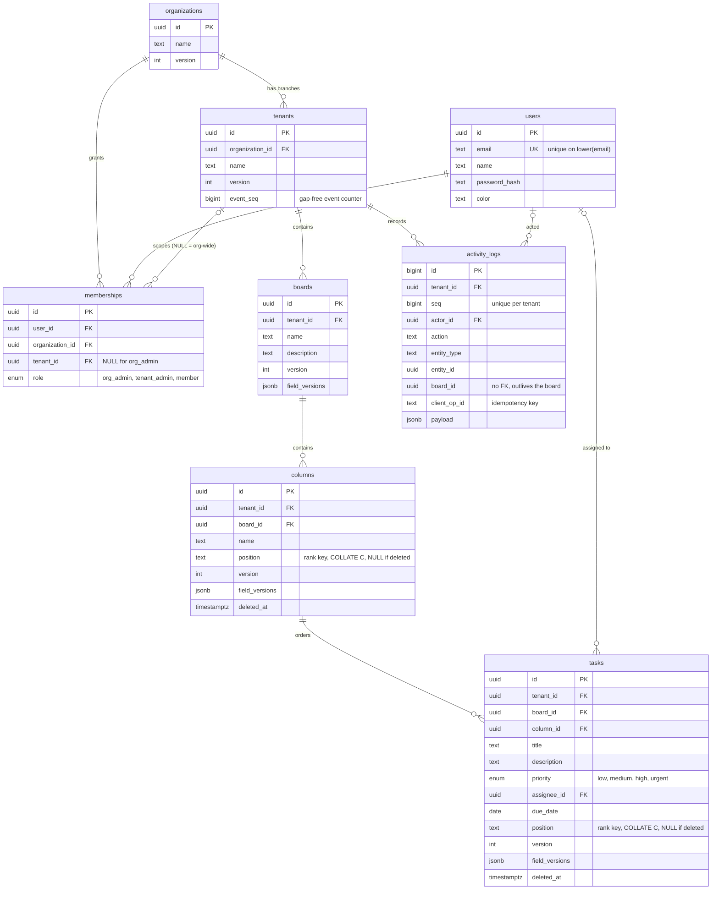

# Database

PostgreSQL. The authoritative definition is
[julley-backend/src/db/migrations/001_schema.sql](../julley-backend/src/db/migrations/001_schema.sql).

## ER diagram



## Isolation

### Composite foreign keys

Every data-plane reference includes `tenant_id`, so a row physically cannot point across tenants. This
holds for every role, including superusers.

| Reference | Guarantees |
|---|---|
| `columns (tenant_id, board_id)` → `boards (tenant_id, id)` | A column is in its board's tenant |
| `tasks (tenant_id, board_id, column_id)` → `columns (tenant_id, board_id, id)` | A task is in its column's board and tenant |
| `memberships (organization_id, tenant_id)` → `tenants (organization_id, id)` | A membership's tenant belongs to its organization |

### Row-level security

The API connects as `kanban_app`: not a superuser, not `BYPASSRLS`, and not the table owner. Scope
comes from transaction-local settings applied by [tenancy.js](../julley-backend/src/db/tenancy.js).

| Table | Rows visible | Rows writable |
|---|---|---|
| `boards`, `columns`, `tasks` | `tenant_id = app.tenant_id` | Same |
| `activity_logs` | `tenant_id = app.tenant_id` | Insert only, same tenant. `UPDATE` and `DELETE` are not granted, so the log is append-only |
| `memberships` | Own rows; rows in the org or tenant scope; org admins of the current tenant's org | Org or tenant scope only, never via "own rows", so nobody can self-grant |
| `tenants` | Those the user has a membership for; or in scope | In scope |
| `organizations` | Those the user has a membership in; or in scope | In scope |

An unset setting reads as `NULL`, and comparing with `NULL` matches nothing, so it fails closed.

## Ordering

`position` holds a fractional rank key. Sorting by it gives display order, and inserting between two
items writes only one row.

- `COLLATE "C"` sorts bytewise, as the key generator does.
- `UNIQUE (column_id, position)` makes duplicates impossible. It is deferrable, so a rebalance can
  rewrite a column in one transaction.
- Soft-deleted rows set `position = NULL`. A `CHECK` ties the two together, and because `NULL`s never
  clash, a deleted row's key can be reused.

## Conflict detection

`version` increments on every change. `field_versions` records who last changed each field and at
which version:

```json
{ "title": { "v": 7, "by": "user-uuid" }, "position": { "v": 5, "by": "user-uuid" } }
```

A request carries a `baseVersion`. A field conflicts only when another user changed it after that
version and the incoming value differs from the current one. See
[fieldPatch.js](../julley-backend/src/domain/fieldPatch.js).

## Events

`tenants.event_seq` is incremented inside each mutating transaction. That row lock is held until commit,
so `activity_logs.seq` is gap-free and in commit order per tenant. It is always the last lock taken, so
it cannot form a deadlock cycle with the column and task locks.

`UNIQUE (tenant_id, actor_id, client_op_id)` is what makes retried requests idempotent.

## Indexes

| Index | Serves |
|---|---|
| `tasks_column_position_key (column_id, position)` | Ordered reads and neighbour lookups in a column |
| `tasks_board_live_idx (tenant_id, board_id) WHERE deleted_at IS NULL` | Board snapshots |
| `activity_logs (tenant_id, seq)` | Replay and activity pagination |
| `activity_logs_idempotency_key` | Retry lookups |
| `memberships_org_admin_key`, `memberships_tenant_key` | One role per user per scope; access checks |
